# 04. Atributos de Calidad

> **Proyecto:** Marketplace & Plataforma de Subastas en Tiempo Real  
> **Capa:** Análisis de Sistema · Atributos No Funcionales y Escenarios

---

## 1. Atributos Identificados y Métricas Objetivo

Durante eventos de alta demanda o subastas en vivo, el sistema experimenta picos masivos de concurrencia donde miles de usuarios consultan bienes y emiten ofertas en el mismo segundo.

| ID | Atributo de Calidad | Escenario de Calidad | Métrica Objetivo | Decisión Arquitectónica Clave |
|:---|:---|:---|:---|:---|
| **AC01** | **Rendimiento (Latencia)** | La recepción de una oferta, validación de reglas, adquisición de lock atómico y difusión a toda la sala debe ser imperceptible para el usuario. | **Tiempo de respuesta P95 $< 50$ ms** en canal en vivo; $< 200$ ms en endpoints REST. | WebSockets nativos en Go + Locks atómicos en Redis In-Memory (`SETNX`). |
| **AC02** | **Disponibilidad** | El sistema debe permanecer operativo durante las sesiones en vivo sin caídas catastróficas por sobrecarga o fallas de APIs externas. | **Disponibilidad $\ge 99.9\%$** durante transmisiones en vivo. | Patrón **Circuit Breaker** en Go para aislar la API de Gemini AI y pasarelas de pago. |
| **AC03** | **Escalabilidad en Recursos Reducidos** | El sistema debe soportar un incremento de usuarios concurrentes operando dentro del límite de memoria de **AWS Free Tier (1 GB RAM)**. | **Soporte $\ge 1,000$ conexiones concurrentes con $< 60$ MB de RAM** en el backend. | Adopción de **Go (Golang)**: Goroutines (~2 KB de stack) en lugar de procesos pesados de Node.js. |
| **AC04** | **Integridad & Concurrencia (Zero Race Conditions)** | Si dos postores envían ofertas idénticas en el mismo milisegundo, solo una debe ser aceptada como líder y la otra debe ser rechazada ordenadamente. | **Cero colisiones transaccionales (100% de orden verificable).** | Mutex atómico distribuido en Redis + agregados inmutables en el dominio de Go. |
| **AC05** | **Seguridad & Prevención de Fraude** | Los datos de postores y transacciones deben estar encriptados en tránsito y reposo; las ofertas sospechosas deben filtrarse antes de adjudicar. | **Tokens JWT en WSS/HTTPS + Scoring predictivo de fraude con IA.** | Middleware de autorización en Go + Integración de Gemini AI + Retención de garantía (*Escrow*). |
| **AC06** | **Mantenibilidad & Testabilidad** | La lógica del negocio debe evolucionar o incorporar nuevos formatos de subasta sin alterar la base de datos o el protocolo de red. | **Cobertura de pruebas unitarias $\ge 80\%$** ejecutables en memoria en $< 1$ segundo. | **Clean Architecture (Hexagonal)**: dominio puro desacoplado mediante interfaces Go (`ports.go`). |
| **AC07** | **Usabilidad y Posicionamiento (SEO)** | Los compradores VIP deben contar con una interfaz cinematográfica rápida y los bienes subastados deben ser indexables por buscadores. | **First Contentful Paint (FCP) $< 1.2$ s** y soporte nativo de SSR. | **Next.js 15 (React 19)** con App Router y diseño exclusivo (*luxury aesthetic*). |

---

## 2. Relación de Atributos con las Capas del Sistema

```mermaid
graph TD
    AC01["⚡ AC01 Rendimiento (< 50ms)"] --> Redis["Redis In-Memory Store"]
    AC01 --> GoSockets["Go WebSocket Hub"]

    AC02["🛡️ AC02 Disponibilidad (99.9%)"] --> CB["Go Circuit Breaker"]
    AC02 --> Fallback["Degradación Heurística Local"]

    AC03["☁️ AC03 Escalabilidad (AWS Free Tier)"] --> GoBin["Binario Go Compilado (~20MB RAM)"]
    AC03 --> RDS["AWS RDS PostgreSQL Separado"]

    AC04["🔒 AC04 Integridad (Zero Collisions)"] --> Redlock["Redis SETNX Atomic Locks"]
    AC04 --> Domain["Domain Aggregate State Machine"]

    AC05["🕵️ AC05 Seguridad & Fraude"] --> JWT["Validación JWT Claims"]
    AC05 --> Gemini["Gemini AI Risk Scoring"]

    AC06["🧩 AC06 Mantenibilidad"] --> CleanArch["Clean Architecture (Ports & Adapters)"]
    AC07["💎 AC07 Usabilidad & SEO"] --> NextJS["Next.js 15 App Router (SSR)"]

    style AC01 fill:#DBEAFE,stroke:#1D4ED8,color:#000
    style AC02 fill:#DBEAFE,stroke:#1D4ED8,color:#000
    style AC03 fill:#DBEAFE,stroke:#1D4ED8,color:#000
    style AC04 fill:#DBEAFE,stroke:#1D4ED8,color:#000
    style AC05 fill:#DBEAFE,stroke:#1D4ED8,color:#000
    style AC06 fill:#DBEAFE,stroke:#1D4ED8,color:#000
    style AC07 fill:#DBEAFE,stroke:#1D4ED8,color:#000
```

