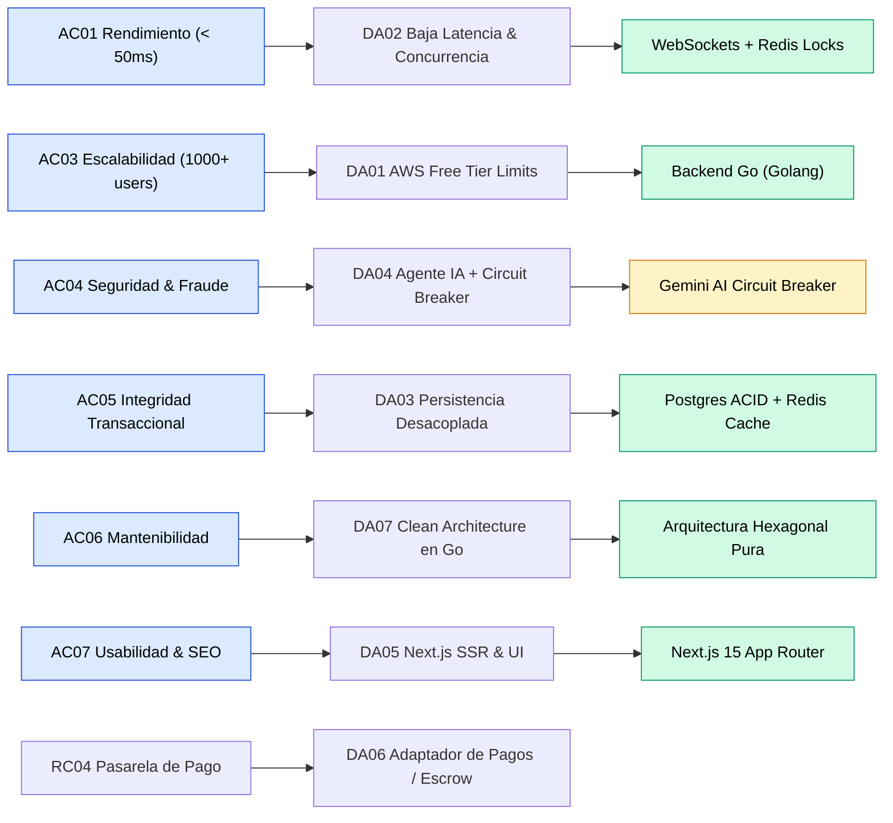

# 06. Drivers arquitectónicos

Los drivers arquitectónicos son el conjunto de requisitos funcionales críticos, atributos de calidad y restricciones técnicas que moldean directamente las decisiones de diseño del sistema.

## Tabla de drivers arquitectónicos

| ID | Driver arquitectónico | Origen | ¿Por qué influye en la arquitectura? | Decisión Arquitectónica Asociada |
|:---|:---|:---|:---|:---|
| **DA01** | **Escalabilidad y Límites de Cómputo en la Nube** | AC03 - Escalabilidad / RC08 - AWS Free Tier | El sistema debe operar dentro de una instancia con recursos limitados (1 GB RAM en AWS `t2.micro` / `t3.micro`) sin colapsar por sobreconsumo de memoria. | Adopción de **Go (Golang)** para el backend central (consumo de ~20 MB RAM frente a >150 MB de Node.js). |
| **DA02** | **Rendimiento y Baja Latencia en Concurrencia** | AC01 - Rendimiento / RC03 - WebSockets | En eventos de alta concurrencia, las transacciones y consultas de precio deben responder en $< 50$ ms sin provocar condiciones de carrera. | Implementación de **WebSockets bidireccionales** en Go y control de concurrencia atómica mediante **Redis Locks (`SETNX`)**. |
| **DA03** | **Desacoplamiento de Persistencia** | AC01 - Rendimiento / AC05 - Mantenibilidad | Almacenar datos en caliente (precios dinámicos, locks atómicos) en la misma base de datos relacional genera saturación de conexiones y cuellos de botella de I/O. | Separación estricta: **Redis 7.2** para caché y locks atómicos en memoria; **PostgreSQL 16** para persistencia transaccional ACID duradera. |
| **DA04** | **Prevención de Fraude e Inteligencia Artificial** | AC04 - Seguridad / RC09 - Gemini AI | Se requiere evaluar preventivamente el riesgo crediticio y conductual del usuario sin bloquear el hilo principal ni comprometer la disponibilidad del sistema. | Integración del modelo **Google Gemini AI** protegido mediante el patrón **Circuit Breaker** en memoria (conmutación automática por timeout > 150 ms). |
| **DA05** | **Experiencia de Usuario de Alta Gama y SEO** | AC07 - Usabilidad / RC07 - Next.js | La interfaz debe ofrecer una experiencia visual exclusiva y fluida en tiempo real, junto con renderizado en servidor (SSR) para indexar bienes en buscadores. | Adopción de **Next.js 15 (React 19)** con App Router y cliente WebSocket reactivo. |
| **DA06** | **Integración de Pasarela de Pagos Externa** | RC04 - Pasarela de pago | Se requiere congelar fondos en garantía (*escrow*) y procesar liquidaciones financieras sin acoplar el código al proveedor bancario. | Aplicación del patrón **Adapter / Hexagonal Architecture** (`PaymentEscrowPort`) con implementaciones intercambiables (Stripe, Niubiz). |
| **DA07** | **Aislamiento de Reglas de Negocio (Mantenibilidad)** | AC06 - Mantenibilidad / RC10 - SDD | El motor central de transacciones debe ser completamente independiente de bases de datos, frameworks web y librerías externas para permitir pruebas unitarias en memoria. | Implementación de **Clean Architecture (Puertos y Adaptadores)** en paquetes modulares en Go (`domain`, `services`, `adapters`). |

## Diagrama de Relación: Requisitos → Drivers → Arquitectura

