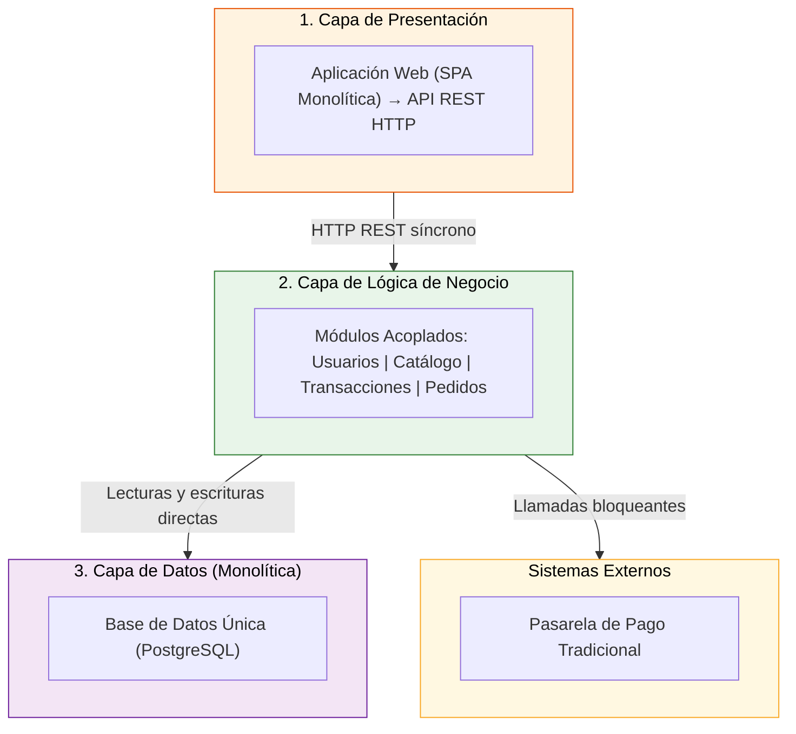
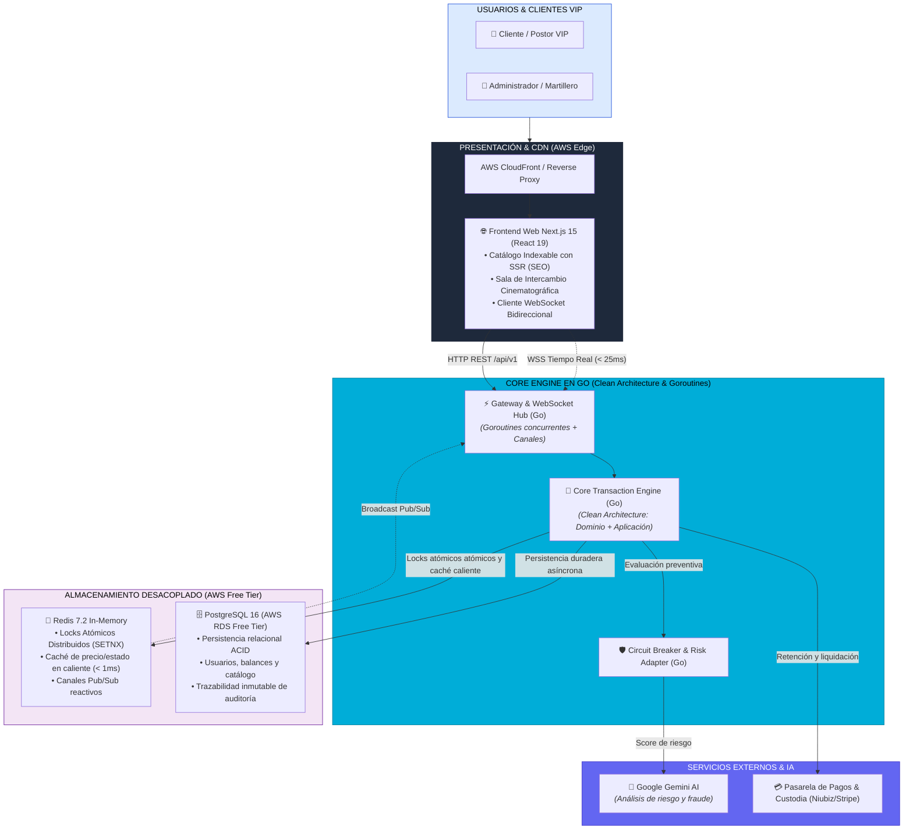

# Arquitectura Inicial y Evolución hacia Startup Escalable

> **Proyecto:** Marketplace & Plataforma de Intercambio / Subastas en Tiempo Real  
> **Capa:** Arquitectura de Software · Evolución de Diseño  
> **Estándar:** Software Design Description (SDD) · Versión 2.0  
> **Enfoque:** Clean Architecture + Event-Driven + Cloud Native (AWS Free Tier)

---

## 1. Arquitectura Inicial (Línea Base de 3 Capas)

En la concepción original del laboratorio, el sistema fue concebido bajo el modelo clásico monolítico de tres capas lineales:

- **Presentación:** Aplicación web cliente consumiendo endpoints HTTP síncronos mediante una API REST tradicional.
- **Lógica de negocio:** Monolito centralizado que encapsulaba usuarios, vendedores (*sellers*), catálogo de bienes y transacciones de pedidos/pujas.
- **Datos:** Una única base de datos relacional compartida (**PostgreSQL**) que soportaba tanto los registros permanentes como las consultas de alta frecuencia.

---

## 2. Diagnóstico Arquitectónico: ¿Por qué la arquitectura inicial no era viable para una Startup?

Tras la evaluación del diseño inicial, se identificaron fallas estructurales críticas que hacían al sistema inviable para operar como una startup real moderna:

| Dimensión | Limitación del Diseño Inicial | Impacto en Producción / Startup | Solución Arquitectónica Adoptada |
|---|---|---|---|
| **Persistencia Acoplada** | Una sola BD relacional (PostgreSQL) atendía tanto el historial contable como la consulta recurrente de precios en caliente. | La contención de disco y bloqueos de fila colapsan la base de datos ante ráfagas concurrentes de peticiones simultáneas. | **Desacoplamiento de Persistencia:** Separación estricta entre **PostgreSQL** (ACID relacional duradero) y **Redis** (In-Memory locks y lecturas en $< 1$ ms). |
| **Consumo de Memoria en la Nube** | Runtime de Node.js consumiendo entre 150 MB y 250 MB de memoria RAM por cada servicio o worker. | **Inviable en AWS Free Tier:** Las instancias gratuitas (`t2.micro` / `t3.micro`) cuentan con únicamente 1 GB de RAM. Múltiples procesos Node.js causan colapso por *OOM (Out Of Memory)*. | **Migración a Go (Golang):** El binario estático compilado consume únicamente **~20 MB de RAM**, permitiendo ejecutar el backend completo junto a Redis en una instancia gratuita. |
| **Latencia de Comunicación** | Peticiones HTTP síncronas tradicionales (*request/response*) o *polling*. | Latencias $> 1.5$ segundos inaceptables para experiencias en vivo y riesgo de condiciones de carrera (*race conditions*). | **WebSockets bidireccionales concurrentes** en Go (`gorilla/websocket`) con Goroutines y Canales para difusión en $< 25$ ms. |
| **Experiencia de Usuario (UI/UX)** | SPA genérica sin renderizado en servidor ni optimización para motores de búsqueda. | Bajo posicionamiento SEO en el catálogo público y experiencia poco profesional. | **Next.js 15 (React 19 / App Router):** SSR para indexación en buscadores y diseño cinematográfico exclusivo. |
| **Seguridad y Fraude** | Validación de reglas manuales sin detección inteligente de anomalías. | Exposición a fraudes transaccionales y compradores sin liquidez. | **Agente de IA (Google Gemini)** con patrón **Circuit Breaker** en memoria para evaluar riesgo sin bloquear el camino crítico. |

---

## 3. Arquitectura Evolucionada y Escalable (Startup-Ready en AWS)

La nueva arquitectura transforma el sistema en una solución desacoplada, reactiva y preparada para alta concurrencia:

---

## 4. Responsabilidades por Componente en el Nuevo Diseño

| Componente | Tecnología | Responsabilidad Principal | Consumo de Recursos en AWS Free Tier |
|---|---|---|---|
| **Capa Web** | Next.js 15, React 19, Tailwind CSS | Renderizado dinámico del catálogo con SSR, gestión de estado reactivo y conexión WebSocket en vivo. | ~120 MB RAM (o Serverless en AWS Amplify/Vercel) |
| **API Gateway & WebSocket Hub** | Go (Golang 1.23+), Gorilla/Coder | Mantiene miles de conexiones simultáneas mediante Goroutines (~2 KB de stack cada una), eliminando cuellos de botella de red. | **~15 MB – 25 MB RAM** |
| **Motor de Negocio (Core)** | Go, Clean Architecture | Aplica las reglas invariantes de dominio (anti-sniping, incrementos por tramo, validación de saldos y adjudicación). | **~20 MB – 30 MB RAM** |
| **Caché & Concurrencia** | Redis 7.2 | Control de concurrencia mediante locks distribuidos atómicos (`SETNX`) y lectura ultrarrápida del estado líder sin estresar la base de datos. | ~30 MB – 50 MB RAM |
| **Base de Datos Principal** | PostgreSQL 16 (AWS RDS Free Tier) | Almacén transaccional definitivo con garantías ACID completas para usuarios, bienes, pagos y auditoría. | Instancia gratuita db.t3.micro (20 GB) |
| **Agente de Confianza / IA** | Google Gemini API + Go Circuit Breaker | Análisis preventivo de patrones de riesgo en transacciones con degradación elegante a reglas locales en memoria si la API externa tarda $> 150$ ms. | Stateless |

---

## 5. Viabilidad en AWS Free Tier

El rediseño permite desplegar la plataforma completa dentro de los límites estrictos de la capa gratuita de AWS:
1. **Memoria Total del Backend:** $< 60$ MB de RAM, garantizando que el sistema operativo y Redis convivan holgadamente en una instancia `t2.micro` o `t3.micro` (1 GB de RAM) sin riesgo de cuelgues por swap o *Out Of Memory*.
2. **Cómputo y Red:** El paso de peticiones bloqueantes a Go con Goroutines permite atender miles de conexiones con una sola CPU virtual (1 vCPU).
3. **Persistencia Desacoplada:** El uso de AWS RDS PostgreSQL en la capa gratuita separa la carga de disco del servidor de cómputo, logrando alta resiliencia.
